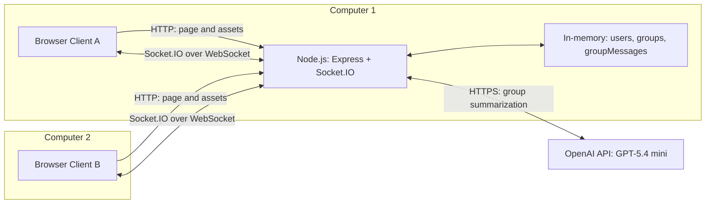

# Architecture: Network Socket Chat

สถานะ: Draft สำหรับ Part 1 และแผนพัฒนา Part 2–3

อ้างอิง: Term Project: Socket Programming — Simple Chat Application หน้า 1–2 ระบบใช้ Node.js + Express + Socket.IO และมี AI สรุปบทสนทนาในกลุ่ม การเลือกเทคโนโลยีและนโยบาย session ในเอกสารเป็นการออกแบบของทีม

## 1. ขอบเขตและสถาปัตยกรรม

ระบบมี server กลางและ browser client อย่างน้อยสองตัวบน **คอมพิวเตอร์จริงคนละเครื่อง** Server รันบนเครื่องเดียวกับ client หนึ่งตัวหรือเครื่องที่สามได้ ผู้ใช้เห็นรายชื่อออนไลน์รวมตัวเอง ส่งข้อความส่วนตัว สร้างกลุ่ม และเข้ากลุ่มด้วยตนเอง แต่ละคู่สนทนาและแต่ละกลุ่มมีห้องแชตแยกกัน



HTTP และ WebSocket ใช้ port เดียวกัน เช่น TCP 3000 ส่วน server ติดต่อ OpenAI ผ่าน HTTPS ขาออกเมื่อสมาชิกกดสรุปข้อความ

## 2. โครงสร้างไฟล์ที่วางแผน

จากสถานะโปรเจกต์ที่ทีมระบุ `client/` ยังไม่มี source file และ `server/index.js` ยังเป็น placeholder โครงสร้างด้านล่างเป็นเป้าหมายสำหรับพัฒนา:

```text
client/
  index.html       # วางแผน: หน้าเข้าใช้ รายชื่อ และห้องแชต
  app.js           # วางแผน: Socket.IO client และการแสดงข้อความ
  styles.css       # วางแผน: รูปแบบหน้าจอ
server/
  index.js         # มี placeholder: จะเพิ่ม Express, Socket.IO และ handlers
  state.js         # วางแผน: users, groups, groupMessages
  ai.js            # วางแผน: เรียก OpenAI API และจัดการข้อผิดพลาด
.env.example      # วางแผน: ชื่อ environment variables พร้อม placeholder เท่านั้น
ARCHITECTURE.md    # เอกสารสถาปัตยกรรม ใช้ชื่อนี้ทุกจุดในโปรเจกต์
```

Client รัน `client/app.js` ใน browser และ server รัน `server/index.js` ด้วย Node.js จึงแยกไฟล์และ process ตามโจทย์ สำหรับขนาดงานนี้ handlers อยู่ใน `server/index.js` และแยกเฉพาะ state กับการเรียก AI ออกเป็นโมดูล

ให้ Express ให้บริการไฟล์ใน `client/` และโหลด browser bundle ของ Socket.IO จาก `/socket.io/socket.io.js` ก่อน `app.js` ใน `client/index.html` เพื่อให้ `io()` พร้อมใช้ โดย Socket.IO server ให้บริการ client bundle ได้ตามค่าเริ่มต้น หากเปลี่ยนไปใช้ bundler และ `import` client library ให้ติดตั้ง `socket.io-client` แยกใน dependencies ตามแนวทางที่เลือก.

## 3. โปรโตคอลและความสัมพันธ์กับ R2

| โปรโตคอล/ชั้นการสื่อสาร | เหตุผลที่เลือก | การใช้ในระบบ |
|---|---|---|
| HTTP | Browser โหลดหน้าเว็บได้โดยตรง | Express ให้บริการ HTML/CSS/JavaScript และเริ่ม WebSocket handshake |
| Socket.IO / Engine.IO | รองรับ events, acknowledgements และ rooms | รับคำขอ ส่งข้อความ และแจ้งการเปลี่ยนแปลงรายชื่อ |
| WebSocket | สื่อสารสองทางผ่าน connection ต่อเนื่อง | เป็น transport เดียวของ Socket.IO สำหรับ browser–server |
| TCP/IP | ส่งข้อมูลตามลำดับและระบุ host/port | รองรับ WebSocket บน LAN IP ของ server ที่ port 3000 |
| HTTPS/TLS | เข้ารหัสการติดต่อบริการภายนอก | Server เรียก OpenAI API; หาก deploy เว็บสาธารณะใช้ HTTPS/WSS ด้วย |

กำหนด transport ทั้งสองฝั่งตาม [client options](https://socket.io/docs/v4/client-options/#transports) และ [server options](https://socket.io/docs/v4/server-options/#transports):

```js
// server/index.js: httpServer ผูกกับ Express
const io = new Server(httpServer, { transports: ["websocket"] });

// client/app.js: เชื่อม origin เดียวกับหน้าเว็บ
const socket = io({ transports: ["websocket"] });
```

การตั้งค่านี้ปิด HTTP long-polling ถ้า WebSocket เชื่อมไม่ได้ ระบบแสดงข้อผิดพลาดและปิดการส่งข้อความ ข้อความแชตระหว่าง browser กับ server ส่งผ่าน Socket.IO เท่านั้น ไม่มี REST endpoint สำหรับส่งหรือดึงข้อความ

**R2 ยังต้องยืนยันกับอาจารย์ก่อนล็อกสถาปัตยกรรม:** PDF ยก Socket.IO และ WebSocket เป็นตัวอย่าง ทีมจึงตีความว่าใช้แนวทางนี้ได้ แต่ Socket.IO มี protocol ของตัวเองเหนือ WebSocket ไม่ใช่ raw WebSocket หรือ raw TCP API การปิด polling ไม่ได้เปลี่ยนข้อแตกต่างนี้ อ้างอิง [What Socket.IO is not](https://socket.io/docs/v4/#what-socketio-is-not) หากผู้สอนกำหนดให้ใช้ raw TCP ทีมต้องปรับ client และ server ก่อนเริ่ม implementation

การเรียก AI ผ่าน HTTPS เป็นช่องทาง server–บริการ AI ส่วนคำขอสรุปและผลสรุประหว่าง browser–server ยังคงผ่าน Socket.IO ทีมจะอธิบายขอบเขตนี้เมื่อยืนยัน R2

## 4. ตัวตน ข้อมูล และอายุของ session

ใช้ `socket.id` เป็นตัวตนของ session และเก็บ state หลักเพียงสามชุดใน server process เดียว:

| State | โครงสร้างและหน้าที่ |
|---|---|
| `users` | `Map<socketId, name>` เก็บผู้ใช้ที่ลงทะเบียนและยังเชื่อมต่อ |
| `groups` | `Map<groupId, {name, members: Set<socketId>}>` เก็บกลุ่มและสมาชิกที่เชื่อมต่ออยู่ |
| `groupMessages` | `Map<groupId, Message[]>` เก็บข้อความกลุ่มล่าสุดไม่เกิน 100 ข้อความ สำหรับประวัติและ AI |

`Message` มี `{from: {socketId, name}, text, sentAt}` ชื่อผู้ส่งและเวลาสร้างโดย server เมื่อรับข้อความ ส่วน `groupId` สร้างโดย server เช่น `crypto.randomUUID()` ข้อมูลทั้งหมดหายเมื่อ server restart

ชื่อผู้ใช้ทำ `trim()` ก่อนบันทึกและตรวจชื่อซ้ำโดยวนเทียบใน `users` แบบไม่แยกตัวพิมพ์ใหญ่/เล็ก ไม่ต้องมี map สำหรับชื่อเพิ่ม ตรวจและเพิ่มชื่อให้เสร็จก่อนทำงาน asynchronous ปฏิเสธชื่อว่างและการลงทะเบียนซ้ำบน socket เดิม

**Member list หมายถึงสมาชิกที่ยังเชื่อมต่ออยู่เท่านั้น** เมื่อ `disconnect` server ลบผู้ใช้ออกจาก `users` และทุกกลุ่ม แล้วแจ้งรายชื่อใหม่ กลุ่มที่ไม่มีสมาชิกยังอยู่ให้คนเลือกเข้าร่วมได้จน server restart ส่วน Socket.IO ออกจาก transport rooms ให้อัตโนมัติ แต่ทีมต้องล้าง state ของระบบเอง อ้างอิง [Rooms: disconnection](https://socket.io/docs/v4/rooms/#disconnection)

เมื่อ connection หลุด client ปิดช่องส่งและล้างข้อมูลห้องใน UI เมื่อเชื่อมใหม่ให้ลงทะเบียนและกดเข้ากลุ่มใหม่ ไม่กู้สมาชิกจากชื่อเดิม ไม่มีการส่งข้อความย้อนหลังที่พลาดไปโดยอัตโนมัติหรือบัญชีผู้ใช้ถาวร

**นโยบายประวัติกลุ่ม:** สมาชิกปัจจุบันอ่านและสรุปข้อความล่าสุดที่ยังเก็บอยู่ได้ รวมข้อความก่อนตนเข้าร่วม โดยรับประวัติผ่าน ack ตอน join ผู้ที่ยังไม่เข้ากลุ่มเห็นเฉพาะชื่อกลุ่มและรายชื่อสมาชิก นโยบายนี้ทำให้ไม่ต้องเก็บลำดับเวลาเข้าร่วมหรือตัวนับข้อความรายสมาชิก

## 5. ห้องแชตและการส่งข้อความ

### 5.1 รายชื่อและ UI

ลงทะเบียนสำเร็จแล้ว client ได้รายชื่อออนไลน์ทั้งหมด **รวมตัวเอง** และทุกกลุ่มพร้อมสมาชิก แสดงชื่อตัวเองพร้อมคำว่า “คุณ” ส่วนการเปิดห้องส่วนตัวเลือกผู้ใช้อื่นจากรายชื่อ

ทุกห้องมี **chat box และปุ่มส่ง** กับ **chat window** ที่แสดงทั้งข้อความขาออกและขาเข้า แสดงเป็น tab หรือ panel ได้ Client เก็บประวัติในหน่วยความจำแยกตามห้อง และแสดงข้อความเป็น plain text ห้องที่ยังไม่ถูกเปิดต้องรับข้อความเก็บไว้ได้โดยไม่ปนกับห้องปัจจุบัน

### 5.2 ข้อความส่วนตัว

1. Client เปิดห้องโดยใช้ socket ID ของคู่สนทนาเป็น key เช่น `private:<peerSocketId>` ไม่ต้องขอเปิดห้องที่ server หากเลือกชื่อตัวเอง ให้ใช้ socket ID ของตนเองเป็น peer key เพื่อรองรับ self-chat
2. ส่ง `private:send` พร้อม `{to, text}` โดย `to` เป็น socket ID ของผู้รับ Server อ่านผู้ส่งจาก `socket.id` และตรวจว่าทั้งผู้ส่งและผู้รับลงทะเบียนแล้ว ผู้รับยังออนไลน์ และข้อความถูกต้อง อนุญาตให้ `to` เป็น socket ID ของผู้ส่งเอง เพื่อให้สอดคล้องกับการแสดงชื่อผู้ใช้ตัวเองในรายชื่อออนไลน์
3. Server ส่ง `private:message` ให้ผู้ส่งและผู้รับเท่านั้น หากผู้ส่งส่งถึงตัวเองให้ส่ง event ไปยัง socket นั้นเพียงครั้งเดียว แล้วตอบ ack สำเร็จ ผู้ใช้อื่นไม่ได้รับ payload
4. รูปแบบ event คือ `{from: {socketId, name}, to: socketId, text, sentAt}` เมื่อรับ event client เลือกคู่สนทนาจาก `from.socketId` หรือ `to` จึงนำทั้งข้อความขาออกและขาเข้ารวมถึง self-chat เข้าห้องเดียวกันในเครื่องนั้น

### 5.3 กลุ่มสนทนา

1. `group:create` รับชื่อกลุ่ม สร้างกลุ่มที่มีผู้สร้างเป็นสมาชิกคนเดียว และให้ socket เข้าห้อง `group:<groupId>` ผู้ใช้สร้างได้หลายกลุ่ม
2. `group:join` รับเฉพาะ `groupId` และเพิ่มสมาชิกได้เฉพาะ `socket.id` ที่ร้องขอ ผู้สร้างเพิ่มคนอื่นไม่ได้ การ join ซ้ำไม่เพิ่มสมาชิกซ้ำ
3. ส่ง `groups:updated` ให้ผู้ใช้ที่ลงทะเบียนทุกคนเมื่อกลุ่มหรือสมาชิกเปลี่ยน โดยส่งเฉพาะรายชื่อ ไม่แนบข้อความ
4. เมื่อรับ `group:send` server ตรวจ membership ก่อนบันทึกข้อความและส่ง `group:message` ด้วย `io.to(groupRoom).emit(...)` ให้สมาชิกทุกคนรวมผู้ส่ง

Socket.IO room ใช้ routing ฝั่ง server ส่วนห้องตาม R5–R6 มี UI และประวัติแยกด้วย อ้างอิง [Socket.IO rooms](https://socket.io/docs/v4/rooms/)

## 6. API: ใช้ ack ตอบคำขอ และ events ส่งข้อมูลทันที

Client ส่ง request พร้อม ack callback Server ตอบ callback **ครั้งเดียว** ด้วย `{ok: true, data: ...}` หรือ `{ok: false, error: {code, message}}` Ack ผูกกับการ emit ครั้งนั้น จึงไม่ต้องมีรหัส request เพิ่ม และไม่ส่ง event ตอบกลับอีกชุด อ้างอิง [Acknowledgements](https://socket.io/docs/v4/emitting-events/#acknowledgements)

| Request: Client → Server | Payload | `data` ใน ack สำเร็จ |
|---|---|---|
| `user:register` | `{name}` | `{self, users, groups}` |
| `private:send` | `{to, text}` | ไม่มีข้อมูลเพิ่ม |
| `group:create` | `{name}` | `{group, messages: []}` |
| `group:join` | `{groupId}` | `{group, messages}` ประวัติล่าสุดของกลุ่ม |
| `group:send` | `{groupId, text}` | ไม่มีข้อมูลเพิ่ม |
| `ai:summarize` | `{groupId}` | `{groupId, summary}` |

ในข้อมูลที่ส่งออก `self`/รายการผู้ใช้เป็น `{socketId, name}` และ `group` เป็น `{groupId, name, members: [{socketId, name}]}` โดยแปลงจาก Map/Set ก่อนส่ง

| Event: Server → Clients | Payload | ผู้รับ |
|---|---|---|
| `users:updated` | `{users}` | ผู้ใช้ที่ลงทะเบียนทั้งหมด |
| `groups:updated` | `{groups}` | ผู้ใช้ที่ลงทะเบียนทั้งหมด |
| `private:message` | `{from, to, text, sentAt}` | ผู้ส่งและผู้รับเท่านั้น |
| `group:message` | `{groupId, from, text, sentAt}` | สมาชิกกลุ่มรวมผู้ส่ง |

**กติกาป้องกันการแสดงซ้ำ:** Client เพิ่มข้อความใหม่ในหน้าต่างจาก message event เท่านั้น ไม่เพิ่มจาก ack หรือก่อน server ตอบ ส่วน ack ของ register/create/join ใช้ตั้งค่า UI และ ack ของ AI ใช้แสดงสรุปในพื้นที่แยกจากข้อความแชต ประวัติจาก ack ของ join ใช้แทนรายการเดิมของห้อง ไม่ append ซ้ำ

Server ตรวจชนิดข้อมูล ชื่อยาว 1–32 ตัวอักษร ข้อความยาว 1–2,000 ตัวอักษรหลัง trim และสิทธิ์ของผู้ร้องขอทุกครั้ง Broadcast รายชื่อเฉพาะ socket ที่ลงทะเบียนแล้ว `disconnect` เป็น lifecycle event ไม่ใช่ request ใน API

เมื่อ offline client ไม่ emit คำขอ เมื่อ ack timeout ให้แจ้งว่าไม่ทราบผลและไม่ retry อัตโนมัติ Ack การส่งข้อความหมายถึง server รับและส่งต่อแล้ว ไม่ใช่ยืนยันว่าผู้รับอ่านแล้ว

## 7. AI feature: สรุปบทสนทนาในกลุ่ม

ทีมเลือก **OpenAI GPT-5.4 mini รุ่น `gpt-5.4-mini-2026-03-17`** ผ่าน Responses API โดยใช้แพ็กเกจ `openai` ใน Node.js และเรียก `client.responses.create(...)` จาก `server/ai.js` ไม่ต้องติดตั้ง runtime หรือโมเดลในเครื่องเพิ่ม อ้างอิง [ข้อมูลโมเดลและ snapshot](https://developers.openai.com/api/docs/models/gpt-5.4-mini) และ [Text generation API](https://developers.openai.com/api/docs/guides/text)

1. สมาชิกกด “สรุปบทสนทนา” Client ส่ง `ai:summarize` พร้อม `groupId`
2. Server ตรวจผู้ใช้และ membership แล้วคัดลอกข้อความล่าสุดไม่เกิน 100 ข้อความจาก `groupMessages` ไม่รับ transcript จาก client และไม่ส่งข้อความส่วนตัวให้ AI
3. `server/ai.js` เรียก API แบบ asynchronous ส่งข้อความพร้อมคำสั่งให้สรุปเป็นภาษาไทย กระชับ อ้างเฉพาะเนื้อหา และถือข้อความแชตเป็นข้อมูล ไม่ใช่คำสั่งให้โมเดลทำตาม หากไม่มีข้อความให้ตอบแจ้งโดยไม่เรียก API
4. เมื่อได้ผล ตรวจว่า socket เดิมยังเชื่อมต่อและเป็นสมาชิก แล้วตอบ summary ผ่าน ack ให้ผู้ร้องขอเท่านั้น UI แสดงผลในช่อง “สรุปโดย AI”
5. จำกัดหนึ่งงานที่ค้างอยู่ต่อ socket และตั้ง API timeout 20 วินาที ปิด automatic retry ของ API client และให้ ack timeout ฝั่ง browser ยาวกว่า เช่น 25 วินาที หากเกิดข้อผิดพลาดให้ตอบ `AI_UNAVAILABLE` โดยการแชตปกติยังทำงาน

**เงื่อนไขสำหรับ demo:** เครื่อง server ต้องมีอินเทอร์เน็ต มี `OPENAI_API_KEY` ใน environment และมีสิทธิ์/โควตาใช้งานโมเดลพร้อมงบ API เก็บ key ฝั่ง server เท่านั้น ไม่ใส่ในไฟล์ client หรือ commit ลง Git ทีมทดสอบตัวอย่างบทสนทนาภาษาไทยและตรวจคุณภาพสรุปก่อน demo หากใช้ไฟล์ `.env` สำหรับพัฒนา ต้องใส่ `.env` และ `.env.*` ใน root `.gitignore` พร้อมยกเว้น `.env.example` ซึ่งมีเฉพาะชื่อ variable และ placeholder ห้ามใส่ key จริง.

**ข้อมูลที่ส่งภายนอก:** ชื่อผู้ส่งและข้อความกลุ่มที่ใช้สรุปจะถูกส่งไป OpenAI เมื่อสมาชิกกดปุ่ม ระบบแสดงข้อมูลนี้ในหน้ากลุ่มก่อนเริ่มใช้งาน และใช้ข้อความตัวอย่างที่ทีมยินยอมให้ส่งออกในการสาธิต ผลสรุปอาจคลาดเคลื่อน จึงแสดงแยกจากข้อความต้นฉบับ

AI นี้นับเป็นหนึ่ง feature ในแผน Part 3 ส่วนคะแนนเต็ม 4 features ต้องมีงานเพิ่มเติม Cloud deployment เป็นตัวเลือกหนึ่ง special point ตามโจทย์ และไม่แทนข้อกำหนด AI

## 8. ตาราง requirement และการสาธิต

| ข้อกำหนด | การออกแบบ / วิธีตรวจรับ |
|---|---|
| Background: client/server คนละไฟล์ | แสดง `client/app.js` กับ `server/index.js` และอธิบายว่าแต่ละไฟล์รันที่ใด |
| R1: ≥2 clients บนคอมพิวเตอร์จริงคนละเครื่อง | ใช้ A/B คนละเครื่อง แสดงแผนภาพ IP/port และอธิบายเหตุผลของแต่ละ protocol |
| R2: ข้อความใช้ Socket Programming เท่านั้น | ยืนยัน Socket.IO กับอาจารย์ก่อนล็อกแบบ และตรวจ WebSocket ใน Network panel |
| R3: ชื่อไม่ซ้ำ | ทดลองชื่อว่าง ชื่อซ้ำ และชื่อที่ต่างเฉพาะตัวพิมพ์/ช่องว่างหัวท้าย |
| R4: เห็นรายชื่อออนไลน์รวมตัวเอง | ตรวจรายชื่อบนทุก client และการอัปเดตตอนเข้า/ออก |
| R5: แยกห้อง private/group | สลับคู่สนทนาและกลุ่ม ข้อความต้องไม่ปนห้อง |
| R6: มี chat box และ chat window | ส่งและรับข้อความในทั้งห้องส่วนตัวและกลุ่ม |
| R7: direct message เห็นเฉพาะคู่สนทนา | A ส่ง B แล้ว C ไม่ได้รับ event; ทดลอง self-chat ด้วยและตรวจว่า event แสดงเพียงครั้งเดียว |
| R8: สร้างหลายกลุ่ม เริ่มมีผู้สร้างคนเดียว | A สร้างสองกลุ่ม แต่ละกลุ่มเริ่มมี A คนเดียว |
| R9: ทุกคนเห็นทุกกลุ่มพร้อมสมาชิก | Client ที่เข้ามาทีหลังได้รายการครบจาก register ack |
| R10: เข้ากลุ่มด้วยตนเอง | B ต้องกด join เอง A ส่ง ID ของ B มาเพิ่มไม่ได้ |
| R11: ข้อความกลุ่มเฉพาะสมาชิก | A/B เป็นสมาชิก C ไม่เป็น; C ไม่ได้รับข้อความและส่งเข้ากลุ่มไม่ได้ |
| Part 3: AI อย่างน้อยหนึ่ง feature | เรียกโมเดลจริง สรุปภาษาไทย ตรวจ non-member และกรณี API ล่ม |
| Implementation Explanation | มีสไลด์อธิบาย socket, ack/events, routing, state, validation และชื่อรุ่น AI พร้อมโค้ด |

## 9. การเตรียม demo

- Bind server ที่ `0.0.0.0:3000` และอนุญาต TCP 3000 ผ่าน firewall ในเครือข่ายสาธิต
- ทั้งสองเครื่องเปิด `http://<server-LAN-IP>:3000` โดยใช้ IP จริง ไม่ใช้ `localhost` จากเครื่องอื่น
- เพิ่มผู้ใช้ C ด้วย browser profile อีกตัวสำหรับทดสอบสิทธิ์ โดย A/B ยังอยู่คนละเครื่องจริง
- ตรวจการหลุด/reconnect ว่ารายชื่อสมาชิกเหลือเฉพาะผู้เชื่อมต่อ และผู้กลับเข้ามาต้องลงทะเบียน/เข้ากลุ่มใหม่
- ตรวจอินเทอร์เน็ต API key โควตาโมเดล และผลสรุปก่อนเริ่มนำเสนอ
- เตรียมสไลด์ Implementation Explanation พร้อมสาธิตและชี้โค้ดตาม requirement: Part 1 ต้องครบจึงตรวจ Part 2 และ Part 2 ต้องครบจึงตรวจ Part 3